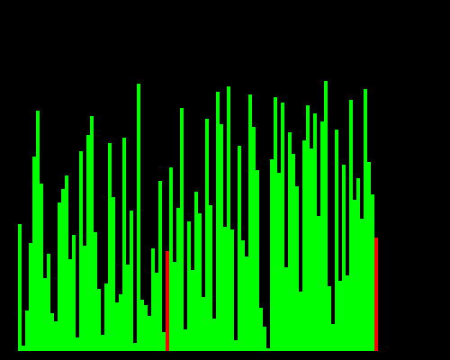
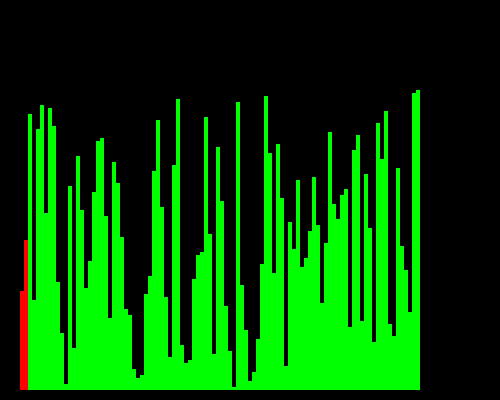
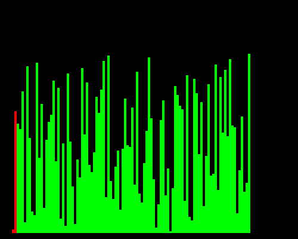
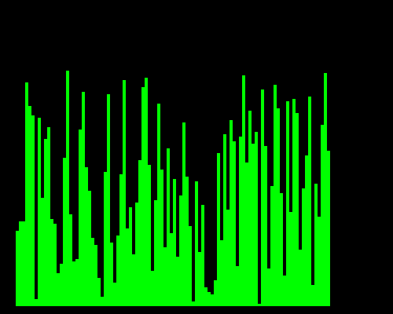
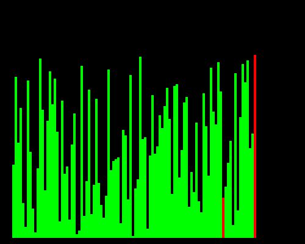
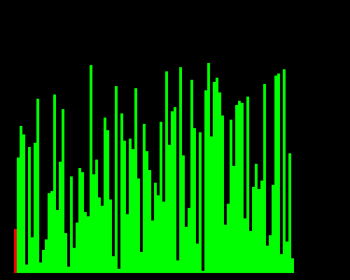

# Sorting Algorithm Visualizer

**Watch sorting algorithms work, bar by bar.**

A small Java Swing app that shuffles a set of bars and then sorts them live, one step at a time, so you can see how each algorithm moves the data around.



> This is a passion project for practice. Its features are meant for enjoyment, **not** education.
> If you still have helpful insights, constructive criticism is welcome.

## How to read the animation

- Each **green bar** is one value. The taller the bar, the bigger the number.
- The **red bars** are the two positions the algorithm is touching right now (swapping, or moving a value from one place to another).
- Every time you press an algorithm button the bars are shuffled first, then sorted from scratch.
- Only one sort runs at a time. Clicks on other buttons while a sort is running are ignored.

## Algorithms

| Button | Best | Average | Worst | Extra memory | What you'll see |
|---|---|---|---|---|---|
| Bubble Sort | O(n²) | O(n²) | O(n²) | O(1) | The biggest bars drift to the right one pass at a time. |
| Improved Bubble Sort | O(n) | O(n²) | O(n²) | O(1) | Same drifting, but each pass stops at the last swap, so the work shrinks faster. |
| Insertion Sort | O(n) | O(n²) | O(n²) | O(1) | A sorted section grows from the left while each new bar slides back into place. |
| Max Sort | O(n²) | O(n²) | O(n²) | O(1) | Finds the tallest remaining bar and drops it at the end. Very few swaps. |
| Quick Sort | O(n log n) | O(n log n) | O(n²) | O(log n) | A random pivot splits the bars into smaller and bigger groups, then each group is split again. |
| Merge Sort | O(n log n) | O(n log n) | O(n log n) | O(n) | Small neighbouring groups are merged into bigger sorted groups. |

Notes on the table:

- Times are comparison counts in terms of `n`, the number of bars.
- Bubble Sort is O(n²) even in its best case because this version always does every pass. The improved version stops early, which is why it can reach O(n).
- Quick Sort uses a random pivot, so its O(n²) worst case is very unlikely in practice.
- Merge Sort needs a second array, so it uses O(n) extra memory.

### Quick look at each one

| | |
|---|---|
| **Bubble Sort**<br> | **Improved Bubble Sort**<br> |
| **Insertion Sort**<br> | **Max Sort**<br> |
| **Quick Sort**<br> | **Merge Sort**<br> |

## How to run it

You need **Java 17 or newer**.

**IntelliJ IDEA:** open the `sorting-algorithms` folder as a project and run `Main`.

**Command line:** from inside the `sorting-algorithms` folder:

```bash
javac -d out src/Main.java src/model/*.java src/view/*.java
java -cp out Main
```

## Tweaking it

Everything you can adjust lives in [`Constants.java`](sorting-algorithms/src/model/Constants.java):

| Constant | Default | What it does |
|---|---|---|
| `DATA_LENGTH` | 100 | How many bars there are. More bars means a longer sort. Stay below about 200, or the bars become too thin to draw. |
| `SORT_DELAY_MS` | 10 | Pause between steps in milliseconds. Lower is faster, higher is slower and easier to follow. |
| `STANDARD_SHUFFLE_NUMBER` | 100 | How many random swaps are used to shuffle the bars before each sort. Higher means a messier start. |
| `FRAME_WIDTH`, `FRAME_HEIGHT` | 500 | Size of the window. |
| `DIAGRAMPANEL_WIDTH`, `DIAGRAMPANEL_HEIGHT` | 500, 400 | Size of the area where the bars are drawn. Bar width and height are worked out from this. |

Try setting `SORT_DELAY_MS` to `1` and `DATA_LENGTH` to `200` to watch the algorithms race through a big pile of bars.
